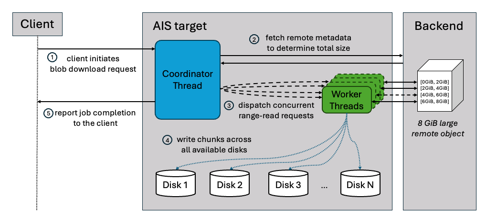

## Blob Downloader

Blob downloader is AIStore's facility for **downloading large remote objects (BLOBs)** using **concurrent range-reads**.
Instead of pulling a 10–100+ GiB object with a single sequential stream, blob downloader:

- **splits the object into chunks** (configurable chunk size),
- **fetches those chunks in parallel** from the remote backend (configurable number of workers),
- **writes them directly into AIStore's chunked object layout** so all target disks are writing in parallel, effectively aggregating the full disk write bandwidth of the node.



The result is that, beyond a certain object size, blob downloader can deliver **much higher throughput** than a regular cold GET. In our internal benchmarks, a 4 GiB S3 object fetched with blob downloader was up to **4× faster** than a monolithic cold GET.

Blob downloader is also **load‑aware**: it consults AIStore's internal load advisors to avoid overcommitting memory or disks, backing off when the node is under pressure and running at full speed when the system has headroom.

Blob downloader shares a target-wide budget of extra range readers with [parallel cold GET](/docs/storage_svcs.md#parallel-cold-get): available mountpaths times a media-type multiplier (see [limits](/docs/howto_large_cold_objects.md#limits-and-defaults)). Every worker except the first counts toward it:

- near the limit, blob downloader uses fewer workers; at the limit, admission is rejected;
- downloads without a client stream (prefetch, `ais blob-download`) get extra workers only while the budget is less than half used, leaving the rest to client GETs;
- a remote 429 or 503 starts target-wide backoff for buckets without `rate_limit.backend`; during backoff, admission is rejected;
- an explicitly requested number of workers is an upper bound: the budget and backoff still apply.


Unlike parallel cold GET into a chunked bucket, which falls back to a single sequential GET - blob downloader does not fall back to sequential range reads on its own.
When the budget, a backoff, or system load leaves fewer than two workers, admission is rejected instead, because a sequential series of range reads costs more backend requests than a regular cold GET.
For the same reason, a requested number of workers must be zero (default) or at least two, and the object must be larger than one chunk.
The default is never less than two workers (e.g., a single HDD mountpath); system load may still reduce it, in which case admission is rejected.

Each range response must match the expected range length (accounting for a shorter final range until EOF). A mismatched length, an ignored range, or a truncated body fails the download before the object gets stored.

Blob downloader uses **pessimistic, per-object concurrency control**. The caller must
hold the object's exclusive write lock before renewal and transfers ownership with the
call. A registered xaction holds the lock for its entire lifecycle and releases it
exactly once after successful finalization, runtime-error cleanup, or abort cleanup. If
renewal does not register an xaction, renewal releases the lock before returning.

Background callers (single-object job, prefetch) qualify an object without holding the
write lock, so blob downloader re-checks it once the lock is taken:

- if the object is now present in-cluster (for instance, via concurrent GET),
  there is nothing to do - unless a latest-version check is requested;
- if it is present and the latest version is requested, blob downloader re-reads remote
  metadata and downloads using the current size and version if they changed.

For objects above a certain threshold, blob downloader can be transparently used by [prefetch](/docs/bucket.md#prefetch-and-evict) - as a performance-optimized alternative to a regular remote ("cold") GET.
At critical memory pressure, [prefetch](/docs/bucket.md#prefetch-and-evict) uses regular cold GET instead of starting blob downloader.
Prefetch also falls back when resource admission rejects blob downloader, the object fits in a single chunk or cannot fit within the manifest chunk limit, or the object's remote size is zero; other start failures are reported.

When admission rejects a client GET (resource pressure, insufficient memory budget, range-reader budget, backoff), the outcome depends on the request:

- explicit blob download (`Ais-Blob-Download` header): HTTP 429 (too many requests), before object headers or body are written;
- blob threshold only (`Ais-Blob-Threshold` header): a regular GET.

Pressure detected after a job starts is reported as an xaction error.

For a deeper dive into the internals and detailed benchmarks, see the [blog post](https://aistore.nvidia.com/blog/2025/11/26/blob-downloader).

---

## Checksums

The stored object's whole-object checksum follows the same rule for standalone jobs, prefetch, and streaming GET:

- With `checksum.type=none`, no object or chunk checksums are computed.
- If the remote object supplies a whole-object checksum and `checksum.validate_cold_get` is false, blob downloader stores that checksum as is.
- Otherwise, if chunks are written sequentially in object order, each finishing before the next starts, blob downloader uses the bucket's configured `checksum.type` (default: `xxhash`).
- Otherwise, it uses CRC32C, combining the per-chunk CRC32C checksums computed during download in object order.

These paths avoid rereading the downloaded chunks.

See [Chunked object checksums](/docs/checksum.md#chunked-objects) for more details.

## Usage

AIStore exposes blob download functionality through three distinct interfaces, each suited to different use cases.

- **Single object blob-download job** – explicitly start a blob-download job for one or more objects.
- **Prefetch + blob-threshold** – route large objects in the prefetch job through blob downloader.
- **Streaming GET** – stream a large object from blob downloader while it is being stored in AIS.

For a comparison with other ways to read large remote objects, including S3 clients, see [Reading large objects from remote buckets](/docs/howto_large_cold_objects.md).

### 1. Single object blob-download job

Use this when you want direct control over which/how objects are fetched with blob downloader.

**Help and options**:

```console
$ ais blob-download --help

NAME:
   ais blob-download - (alias for "job start blob-download") Download a large object or multiple objects from remote storage, e.g.:
     - 'blob-download s3://ab/largefile --chunk-size=2mb --progress'       - download one blob at a given chunk size
     - 'blob-download s3://ab --list "f1, f2" --num-workers=4 --progress'  - run 4 concurrent readers to download 2 (listed) blobs
   When _not_ using '--progress' option, run 'ais show job' to monitor.

USAGE:
   ais blob-download BUCKET/OBJECT_NAME [command options]

OPTIONS:
   chunk-size value   Chunk size in IEC or SI units, or "raw" bytes (e.g.: 4mb, 1MiB, 1048576, 128k)
   num-workers value  Number of concurrent blob-downloading workers (readers); system default when omitted or zero (default: 0)
   list value         Comma-separated list of object or file names
   latest             Check and optionally synchronize the latest object version from the remote bucket
   progress           Show progress bar(s) in real time
   wait               Block until the job finishes (optionally use '--timeout' to limit waiting time)
   ...
```

**Examples**:

- **Single large object**

  ```console
  $ ais blob-download s3://my-bucket/large-model.bin \
        --chunk-size 4MiB \
        --num-workers 8 \
        --wait --progress
  ```

- **Multiple objects in one job**

  ```console
  $ ais blob-download s3://my-bucket \
        --list "obj1.tar,obj2.bin,obj3.dat" \
        --chunk-size 8MiB \
        --num-workers 4 \
        --wait --progress
  ```

### 2. Prefetch with blob-threshold

`prefetch` is AIStore's **multi‑object “warm‑up” job** for remote buckets. A positive threshold below the prefetch minimum (see [limits](/docs/howto_large_cold_objects.md#limits-and-defaults)) is first raised to it. Prefetch then selects the fetch path as follows:

- With bucket auto-chunking enabled, objects **≥ max(`--blob-threshold`, `chunks.objsize_limit`)** are fetched via blob downloader.
- With auto-chunking disabled, objects **≥ `--blob-threshold`** are fetched via blob downloader (parallel range‑reads, chunked writes).
- Objects below the applicable threshold are fetched with the normal cold GET path.

This lets you get the large‑object gains of blob downloader by just tuning prefetch's knobs.

**Example**:

```console
# Inspect a remote bucket
$ ais ls s3://my-bucket
NAME             SIZE            CACHED
model.ckpt       12.50GiB        no
dataset.tar      8.30GiB         no
config.json      4.20KiB         no

# Prefetch with 1 GiB threshold:
# - with auto-chunking enabled, objects ≥ max(1GiB, chunks.objsize_limit) use blob downloader
# - otherwise, objects ≥ 1GiB use blob downloader
# - smaller objects use standard cold GET
$ ais prefetch s3://my-bucket \
      --blob-threshold 1GiB \
      --blob-chunk-size 8MiB \
      --wait --progress
prefetch-objects[E-abc123]: prefetch entire bucket s3://my-bucket
```

Key prefetch options:

- **`--blob-threshold SIZE`**: enable blob downloader at this size (also bounded by `chunks.objsize_limit` when auto-chunking is enabled).
- **`--blob-chunk-size SIZE`**: chunk size when bucket auto-chunking is disabled; otherwise `chunks.chunk_size` applies.
- **`--prefix` / `--list` / `--template`**: scope which objects are prefetched.

### 3. Streaming GET

In addition to CLI jobs, blob downloader can be used to stream large objects while they are concurrently downloaded in the cluster. This is useful when you want to feed data directly into an application (for example, model loading or preprocessing) and still keep a copy in AIS.

```python
from aistore import Client
from aistore.sdk.blob_download_config import BlobDownloadConfig

# Set up AIS client and bucket
client = Client("AIS_ENDPOINT")
bucket = client.bucket(name="my_bucket", provider="aws")

# Select and tune server-side blob download
blob_cfg = BlobDownloadConfig(
    threshold=64 * 1024 * 1024,
    chunk_size="4MiB",
    num_workers="16",
    read_timeout="30s",
)

# Use the blob downloader for remote objects at least 64 MiB in size
reader = bucket.object("my_large_object").get_reader(
    blob_download_config=blob_cfg,
)
data = reader.read_all()
```

`BlobDownloadConfig.num_workers` controls server-side blob-download readers. `Object.get_reader(num_workers=...)` is a separate client-side mode and cannot be combined with this configuration.

### Size limits

Each interface applies its own minimum object size (for the values, see [limits](/docs/howto_large_cold_objects.md#limits-and-defaults)):

| Interface | Blob downloader is used for | Otherwise |
|-----------|-----------------------------|-----------|
| Single-object job (`ais blob-download`, `api.BlobDownload`) | objects larger than one chunk | zero size or a single chunk: error |
| Prefetch (`--blob-threshold`; zero disables) | objects at or above `max(blob-threshold, prefetch minimum, chunks.objsize_limit)` when auto-chunking is enabled; otherwise `max(blob-threshold, prefetch minimum)`; larger than one chunk | regular cold GET |
| Streaming GET (`Ais-Blob-Download`, `Ais-Blob-Threshold`) | objects at or above `max(Ais-Blob-Threshold, GET minimum)`; larger than one chunk | regular GET; no blob-download job |

Notes:

- prefetch rejects a negative `--blob-threshold`; positive values below the prefetch minimum are raised to it (with a warning);
- rarely, if the object's remote version shrinks before
  prefetch rechecks it under write-lock, blob downloader may still be engaged (and process it below the threshold);
- once its regular (non-blob) work is done, prefetch waits up to 32 minutes for pending blob downloads;
  on timeout, it aborts both itself and the downloads that are still running.

---

## Selecting an effective blob-threshold for prefetch

The ideal `--blob-threshold` depends on your cluster (CPU, disks, network), backend (S3/GCS/…​), and object size distribution.
Running full `prefetch` experiments for many candidate values can easily take **hours**, so instead we recommend using a **shorter single‑object blob-download benchmark** to pick a good starting point and then using that value directly in your prefetch job.

To do this in practice, **compare cold GET vs. blob-download on a single object**:

1. **Pick a representative large remote object** in your bucket (for example, a model shard or big archive).
2. **Evict it from AIStore** to ensure a cold path:

   ```console
   $ ais evict s3://my-bucket --list "large-model.bin"
   ```

3. **Measure cold GET time** for that object:

   ```console
   $ time ais get s3://my-bucket/large-model.bin /dev/null
   ```

4. **Measure blob-download time** for the same object:

   ```console
   $ ais evict s3://my-bucket --list "large-model.bin"

   $ time ais blob-download s3://my-bucket/large-model.bin --wait
   ```

5. Repeat the above for a few object sizes (for example: 64 MiB, 256 MiB, 1 GiB, 4 GiB) until you see a pattern:

- **Below some size**, cold GET is as fast or faster (blob overhead dominates).
- **Above that size**, blob-download is consistently faster.

The **crossover size** where blob-download _wins_ is your **blob-threshold** for prefetch: use that size as `--blob-threshold` when you run your real `ais prefetch` job. This single‑object comparison gives you a quick, reasonable approximation.

In our internal 1.56 TiB S3 benchmark, applying this method led us to a threshold of about **256 MiB**. This value provided the best trade‑off for that specific cluster and workload and delivered roughly **2.3× faster** end‑to‑end prefetch compared to a pure cold‑GET baseline.
