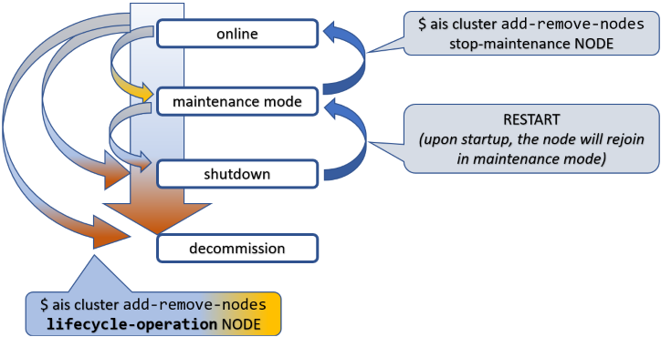

# AIStore Node Lifecycle

This guide covers how AIStore nodes join and rejoin a cluster, and how operators put nodes into maintenance, shut them down, or decommission them. The diagram shows the states and transitions for nodes that are already members.



To put things in perspective, this picture is about a node (not shown) in an AIStore cluster (also not shown).

Tracking it from top to bottom, first notice the state called **maintenance mode**. This is the gentlest way to remove a node from an operating cluster. When in maintenance, the node stops keepalive heartbeats but remains in the cluster map. A target must remain online while rebalance migrates its data. Successful completion marks it `maintenance-post-rebalance` in the Smap; it can then be disconnected or shut down.

Next comes **shutdown**. Graceful shutdown can also be achieved in a single shot, as indicated by one of the arrows on the left:

`online => shutdown`

When in `shutdown`, the node can later return and rejoin the cluster. That takes two steps, not one: restart the node first, then take it out of maintenance. In the diagram, `RESTART` must be understood as a deployment-specific action such as `kubectl run`, restarting a systemd unit, or powering the machine back on.

Normally, taking a target into `maintenance` or `shutdown` involves an intra-cluster operation called **global rebalance**; `--no-rebalance` skips it.

The third and final special state is **decommission**. On the normal rebalance path, the cluster attempts to migrate data from the departing target to other online targets before removing it. Rebalance errors do not always prevent removal; with `--no-rebalance`, migration is skipped. Decommission also entails:

* partial or complete cleanup of the node itself; and
* removing AIS metadata and configuration files. Local user data is removed when `--rm-user-data` is specified.

Needless to say, there's no simple way back out of `decommission` - the proverbial point of no return. A decommissioned node does not come back by restarting it: depending on how far the cleanup progressed, it must be re-added with an explicit `join` or redeployed from scratch.

## Table of Contents

- [Joining a Cluster: Discovery URL](#joining-a-cluster-discovery-url)
- [Node identity and rejoining](#node-identity-and-rejoining)
  - [Node ID sources](#node-id-sources)
  - [Pod-derived IDs](#pod-derived-ids)
  - [Operator-managed ID source](#operator-managed-id-source)
  - [What happens after a pod restart](#what-happens-after-a-pod-restart)
  - [Troubleshooting pod-derived IDs](#troubleshooting-pod-derived-ids)
- [Cluster](#cluster)
- [Privileges](#privileges)
- [Rebalance](#rebalance)
  - [Proper Location](#proper-location)
  - [Quick Example](#quick-example)
- [Putting a Node in Maintenance](#putting-a-node-in-maintenance)
  - [Batch Operations](#batch-operations)
  - [Incomplete Transitions](#incomplete-transitions)
  - [Skipping Rebalance](#skipping-rebalance)
- [One Membership Change at a Time](#one-membership-change-at-a-time)
- [Clearing Maintenance State](#clearing-maintenance-state)
- [Removing a Node from a Cluster](#removing-a-node-from-a-cluster)
- [Checking Removal Status](#checking-removal-status)
- [Summary](#summary)
- [References](#references)

## Joining a Cluster: Discovery URL

AIStore clusters can be deployed with an arbitrary number of AIStore proxies (a.k.a. gateways). Each proxy implements RESTful APIs, both native and S3-compatible, and provides full access to user data stored in the cluster.

Each proxy collaborates with the others to perform majority-voted HA failovers; see [Highly Available Control Plane](/docs/ha.md). All _electable_ proxies are functionally equivalent. The one elected as the current _primary_ is, among other things, responsible for joining nodes to the running cluster.

To facilitate node joins in the presence of disruptive events such as:

* network failures; and/or
* partial or complete loss of local AIS metadata such as cluster maps,

AIStore uses the so-called *original* and *discovery* URLs in the cluster configuration. The latter is versioned, replicated, protected, and distributed solely by the elected primary.

> **March 2024 update:** starting with v3.23, the *original* URL does _not_ track the original primary. Instead, the current primary takes full responsibility for updating both URLs with a single purpose: optimizing time to join or rejoin the cluster.

When an HA event triggers automated failover, the role of primary is assumed by a different proxy, with the corresponding cluster map (Smap) update synchronized across all running nodes.

A new node, however, may still have configuration that refers to the old primary. The *original* and *discovery* URLs exist precisely to address that scenario:

```console
$ ais config cluster proxy --json
{
    "proxy": {
        "primary_url": "https://ais-proxy-15.ais-proxy.ais.svc.cluster.local:51082",
        "original_url": "https://ais-proxy-15.ais-proxy.ais.svc.cluster.local:51082",
        "discovery_url": "https://ais-proxy.ais.svc.cluster.local:51082",
        "non_electable": false
    }
}
```

## Node identity and rejoining

The discovery URL tells a starting node where to find the cluster. Its node ID tells the primary which member is joining. The ID appears in the cluster map (Smap), logs, and CLI. When the primary accepts a same-ID rejoin with changed network addresses, it updates the existing Smap entry.

Object placement uses target IDs. When restarting or moving a target, keep its ID and its data volumes together.

A node that loads a local Smap without its own ID stops at startup.

### Node ID sources

Both proxies and targets first check for [pod-derived IDs](#pod-derived-ids). When that mode is unset, an optional explicit ID takes precedence over the role-specific startup paths below. AIS checks `-daemon_id` before `AIS_DAEMON_ID` (command line always takes precedence over environment).

#### Proxy startup

A proxy running in Kubernetes derives its ID from the Kubernetes node name (`MY_NODE`). Otherwise, it reuses the ID in `.ais.proxy_id` in its configuration directory. If there is no saved ID, it generates one and saves it there.

#### Target startup

A target reuses the ID in the `user.ais.daemon_id` extended attribute at the root of its configured mountpaths. The IDs it finds must agree. If none of the mountpaths has the attribute, the target tries to recover its ID from the `daemon_id` field in a copy of `.ais.vmd` (volume metadata). It uses a newly generated ID when neither source supplies one.

The xattr identifies the owner of each mountpath. The replicated VMD records the same target ID along with the target's mountpath configuration. See [System Files](/docs/sysfiles.md#system-files) and [storage integrity errors](/docs/troubleshooting.md#storage-integrity-errors-sie).

#### Generating a new ID

The default generator produces eight random letters. In a development setup with `test_fspaths.count > 0`, it appends the role and public port to a random prefix. For example, a proxy ID ends in `p8080` and a target ID can end in `t8081`. See [the local playground](/docs/getting_started.md#local-playground).

### Pod-derived IDs

Opt-in mode for **new** AIStore clusters deployed in Kubernetes: AIS derives the node ID from the pod identity, so that the ID follows the pod across Kubernetes nodes and does not depend on local state.

| Node | Default | `AIS_DAEMON_ID_SOURCE=k8s-pod:<scope>` |
|---|---|---|
| Proxy | Hash of the Kubernetes node name (`MY_NODE`); changes when the pod moves | Same ID on any Kubernetes node |
| Target | Read from its mountpaths; new random ID when all mountpaths are blank | Same ID on any Kubernetes node, with or without its volumes |

AIS recomputes the eight-letter ID at every startup from:

* role (`-role`)
* namespace (`K8S_NS`)
* pod name (`MY_POD`)
* scope: the part after `k8s-pod:`

The `-daemon_id_source` flag takes precedence over the `AIS_DAEMON_ID_SOURCE` environment variable. AIS does not query Kubernetes for any of the inputs.

Within a single Kubernetes cluster, namespace and pod name are already unique. The scope distinguishes:

* AIS clusters with identical namespaces and pod names in different Kubernetes clusters
* a re-created AIS cluster from its predecessor, so that leftover volumes cannot join the new cluster

#### Division of responsibilities

| Deployment ([AIS K8s Operator](https://github.com/NVIDIA/ais-k8s) or other) | AIS |
|---|---|
| Set `AIS_DAEMON_ID_SOURCE` on proxy and target containers | Derive the ID; exit on invalid or conflicting settings |
| Set `MY_POD` and `K8S_NS` (the Operator always does) | Exit if either is missing |
| Keep pod names stable (StatefulSet) | - |
| Attach each target's volumes to the same pod after rescheduling (per-pod volume claims) | Reject mountpaths that belong to a different target (`sie#10`, `sie#20`) |
| Preserve the ID source and scope in every operation that starts or replaces a daemon | Recompute the ID from the inputs supplied at startup |

#### Recommended usage

* New clusters only. Enabling pod-derived IDs on an existing cluster changes every node ID, and targets then fail to start with `sie#10` or `sie#20`.
* One scope per AIS cluster, the same for proxies and targets. Keep it in the deployment spec: a value generated once survives deleting and re-creating the custom resource (with metadata preserved); the custom resource UID does not.
* Leave `-daemon_id` and `AIS_DAEMON_ID` unset.
* The unscoped `k8s-pod` is accepted but not recommended.

For example, in the AIStore custom resource:

```yaml
spec:
  proxySpec:
    env:
      - name: AIS_DAEMON_ID_SOURCE
        value: k8s-pod:6f1c2b7e-3d4a-4c5b-9e8f-0a1b2c3d4e5f
  targetSpec:
    env:
      - name: AIS_DAEMON_ID_SOURCE
        value: k8s-pod:6f1c2b7e-3d4a-4c5b-9e8f-0a1b2c3d4e5f
```

At startup, each node logs the derived ID, for example:

```
initialized t[GBLgBUup] from AIS_DAEMON_ID_SOURCE="k8s-pod:6f1c2b7e-3d4a-4c5b-9e8f-0a1b2c3d4e5f" (pod ais/ais-target-1)
```

### Operator-managed ID source

For pod-derived IDs, it is recommended that AIS/K8s Operator API makes the ID source and optional scope a single **creation-time** setting in the AIStore custom resource.

The Operator would set `AIS_DAEMON_ID_SOURCE` in both StatefulSet pod templates and reject attempts to add, remove, or change the setting on an existing resource. Restarts, upgrades, and rescheduling would then inherit the original setting.

Use the environment variables in the example above today. When recreating the custom resource with existing volumes, restore the original ID source and scope from the deployment spec.

See related [Troubleshooting pod-derived IDs](#troubleshooting-pod-derived-ids) section below.

### What happens after a pod restart

The following cases assume pod-derived IDs.

| Event | Result |
| --- | --- |
| Proxy restarts with fresh local state and the same pod identity | The proxy derives the same ID and rejoins. |
| Proxy or target moves to another Kubernetes node | Same ID. If the previous Smap entry is still present, an accepted self-join updates it. If the entry has already been removed, self-join adds it back. |
| Target restarts or moves with its original volumes | The target derives the same ID, loads its VMD, and rejoins with its data. |
| Target returns with blank volumes | The target derives the same ID and creates a new VMD. The primary treats it as the same member. |
| Target receives another target's volumes, even alongside blank volumes | Startup fails with `sie#10` or `sie#20`. |
| Target starts with a different scope and retains its old volumes | Startup fails with `sie#10` or `sie#20`. |

At startup, AIS checks the target ID in mountpath extended attributes and VMD for the volumes it will use, the same way as for an explicit ID (`AIS_DAEMON_ID`). It stamps mountpaths that lack an ID, independently of the object metadata write policy (`write_policy.md`). At runtime, attaching or enabling a mountpath with a foreign ID in its extended attribute fails with `sie#10`. See the [storage integrity error reference](/docs/troubleshooting.md#sie-error-reference).

**Blank volumes do not recover local data.** AIS does not detect that an existing target has returned with blank volumes. Objects backed by remote buckets can be fetched again on a cold GET. Objects in `ais://` buckets with no surviving copies are lost.

### Troubleshooting pod-derived IDs

Keep the original ID source in the deployment spec or launch configuration used for restarts, upgrades, rescheduling, and manual recovery. AIS selects the source on every start from the daemon's command line and environment. The Smap and volumes record the resulting ID, so the deployment must supply the source and scope again. Check the effective value: a nonempty `-daemon_id_source` overrides `AIS_DAEMON_ID_SOURCE`.

| Symptom | Cause | Action |
|---|---|---|
| After a restart or replacement, a pod comes back with a different ID or startup reports that its ID is absent from the local Smap | A deployment using pod-derived IDs omitted the source or changed the scope. With both settings absent, a proxy falls back to `MY_NODE`. A target can still recover its previous ID from its volumes, so a successful restart with the original disks can hide the missing setting until a replacement starts with blank volumes. | Restore the original source and scope, and check the role, `MY_POD`, and `K8S_NS`. Confirm the derived ID in the startup log. |
| An existing deployment starts deriving IDs after a restart or upgrade, or a target exits with `sie#10` or `sie#20` | A deployment using the default or explicit ID source picked up `-daemon_id_source` or `AIS_DAEMON_ID_SOURCE` from a changed command line or environment. | Remove both pod-source settings from the launch configuration and restore the original ID settings. |
| Exit: `invalid AIS_DAEMON_ID_SOURCE` | Value is neither `k8s-pod` nor `k8s-pod:<scope>` | Fix the value. |
| Exit: `AIS_DAEMON_ID_SOURCE requires MY_POD and K8S_NS` | Missing environment | Set both from the pod's `metadata.name` and `metadata.namespace`. |
| Exit: `AIS_DAEMON_ID_SOURCE cannot be combined with ...` | Explicit ID is also set | Remove `-daemon_id` and `AIS_DAEMON_ID`. |
| Target exits with `sie#10` or `sie#20` | A mountpath belongs to a different target: wrong volume attached, changed scope, renamed pod or namespace, or pod-derived IDs enabled on an existing cluster | The startup error includes the pod namespace and name and both target IDs. Restore the original volume-to-pod mapping or the original `AIS_DAEMON_ID_SOURCE`. Do not remove the extended attribute to force startup: the volume holds another target's data. |
| Target rejoins with no objects | Blank volumes | See the note on blank volumes above. |

## Cluster

There is one cluster-level lifecycle command that deserves to be called out separately:

```console
$ ais cluster decommission --rm-user-data --yes
```

The above command destroys an existing cluster - completely and utterly, no questions asked. It is useful in testing, benchmarking, and other non-production environments. See `--help` for details.

## Privileges

All lifecycle management commands and their associated APIs require administrative privileges.

Broadly, there are three ways to satisfy that requirement:

* deploy the cluster with authentication disabled:

```console
$ ais config cluster auth --json
{
    "auth": {
        "signature": {
            "key": "**********",
            "method": "hmac"
        },
        "required_claims": {
            "aud": null
        },
        "oidc": {
            "issuer_ca_bundle": "-",
            "allowed_iss": null
        },
        "intra_cluster": {
            "request_auth": false,
            "node_join_secret_path": "",
            "ttl": "0s",
            "nonce_window": "1m",
            "rotation_grace": "1m"
        },
        "client_auth_required": false
    }
}
```

Here, `client_auth_required: false` means protected client requests do not require authentication.

* use the integrated `AuthN` server, which provides OAuth 2.0-compliant JWTs and a set of [CLI auth commands](/docs/cli/auth.md) to manage users, roles, and permissions; or
* outsource authorization to a separate centralized system, often LDAP-integrated, that manages existing users, groups, and mappings.

## Rebalance

Conceptually, AIStore rebalance is somewhat similar to what is often called a RAID rebuild. The underlying mechanics are different, but the high-level idea is similar: user data migrates from some nodes in a cluster to other nodes to restore the correct placement.

In AIStore, rebalancing is the system response to a lifecycle event that has already happened or is about to happen. Its singular purpose is to satisfy one governing rule:

**user data must be *properly* located**

### Proper Location

For any object in a cluster, its proper location is defined by the current cluster map and, locally on each target, by the configured target [mountpaths](/docs/terminology.md#mountpath).

In that sense, the `maintenance` state, for instance, has its beginning when the cluster starts rebalancing, and its post-rebalancing end when the corresponding sub-state is recorded in the next Smap version and safely distributed across all nodes.

### Quick Example

Given a 3-node single-gateway cluster, suppose we shut down one of the nodes:

```console
$ ais cluster add-remove-nodes shutdown <TAB-TAB>
p[BkTqWmFd]   t[QrmZvKdN]   t[XvnGkRdM]   t[ZdpKcVnT]

$ ais cluster add-remove-nodes shutdown 't[QrmZvKdN]' -y

Started rebalance "g47" (to monitor, run 'ais show rebalance').
t[QrmZvKdN] is shutting down, please wait for cluster rebalancing to finish

Note: the node t[QrmZvKdN] is _not_ decommissioned - it remains in the cluster map and can be manually
restarted at any later time (and subsequently activated via 'stop-maintenance' operation).
```

Once the command is executed, notice the following:

```console
$ ais show cluster
...
t[QrmZvKdN][x]   -   -   -   -   maintenance
```

At first, `maintenance` will show up in red, indicating a simple fact: data is expeditiously migrating from the node that is about to leave the cluster.

> A visual cue that effectively says: please don't disconnect it yet, and do not power it off.

Eventually, if you run:

```console
$ ais show cluster --refresh 3
```

or simply check a few times manually, the output will report that rebalance (`g47` in this example) has finished and the node `t[QrmZvKdN]` has gracefully left service. Simultaneously, `maintenance` in the `show` output becomes non-red:

| when rebalancing             | after                         |
| ---------------------------- | ----------------------------- |
| $${\color{red}maintenance}$$ | $${\color{cyan}maintenance}$$ |

On this normal shutdown path, AIS stops the target after the associated [global rebalance](/docs/rebalance.md) completes successfully. If rebalance is interrupted or reports errors, the target remains in maintenance; see [Incomplete Transitions](#incomplete-transitions).

## Putting a Node in Maintenance

To temporarily take a node out of the cluster, put it in maintenance mode. Nodes in maintenance remain in the cluster map but stop participating in normal request processing.

```console
$ ais cluster add-remove-nodes start-maintenance 't[QrmZvKdN]'
Started rebalance "g1" (to monitor, run 'ais show rebalance').
t[QrmZvKdN] is now in maintenance mode
```

Alternatively, you can shut the node down as part of the same workflow:

```console
$ ais cluster add-remove-nodes shutdown 't[QrmZvKdN]'
Started rebalance "g1" (to monitor, run 'ais show rebalance').
t[QrmZvKdN] is shutting down, please wait for cluster rebalancing to finish

Note: the node t[QrmZvKdN] is _not_ decommissioned - it remains in the cluster map and can be manually
restarted at any later time (and subsequently activated via 'stop-maintenance' operation).
```

If the node is a target, the cluster normally rebalances after a short preparation phase. Before manually powering off a target in maintenance, see [Checking Removal Status](#checking-removal-status).

### Batch Operations

`start-maintenance`, `stop-maintenance`, `shutdown`, and `decommission` all accept multiple nodes:
`NODE_ID [NODE_ID...]`, comma- or space-separated. TAB completion suggests the nodes not yet selected.

The batch executes as one coordinated operation. Each lifecycle phase updates the cluster map once for
the entire batch. When rebalance is required, the cluster performs one RMD increment and starts
one global rebalance, regardless of how many nodes you specify:

```console
$ ais cluster add-remove-nodes start-maintenance <TAB-TAB>
p[BkTqWmFd]   t[XvnGkRdM]   t[QrmZvKdN]   t[ZdpKcVnT]   t[HbjTwLpS]   t[NwLjRbGq]

$ ais cluster add-remove-nodes start-maintenance 't[QrmZvKdN]' 't[HbjTwLpS]' --yes
Started rebalance "g1" (to monitor, run 'ais show rebalance').
t[QrmZvKdN] is now in maintenance mode
t[HbjTwLpS] is now in maintenance mode
```

The three remaining targets receive the migrating data - a single `g1` for the pair, not one rebalance per node:

```console
$ ais show rebalance
REB ID   NODE       TX OBJECTS   TX BYTES   RX OBJECTS   RX BYTES   START      END   STATE
g1       ZdpKcVnT   0            0B         42695        41.69MiB   12:11:28   -     Running
g1       NwLjRbGq   0            0B         42555        41.56MiB   12:11:28   -     Running
g1       XvnGkRdM   0            0B         42961        41.95MiB   12:11:28   -     Running

$ ais wait rebalance g1
Waiting for rebalance[g1] ...
Done.
```

Admission is all-or-nothing: if any specified node is unknown or is the current primary, the entire request
is rejected and no node is touched. Conversely, once the transaction is underway, a node that
disappears - keepalive-removed, for instance - does not abort it; the remaining nodes complete
normally.

Operation-specific state checks also apply. `start-maintenance` skips a node that has already completed
the same transition, and `stop-maintenance` skips a node that is already active. If every specified node is
skipped, the command reports "nothing to do" and leaves the cluster map untouched. A node in
maintenance can be advanced to `shutdown` or `decommission`; `stop-maintenance` refuses a node that
is being decommissioned.

Advancing a node already in maintenance does not rebalance when the batch contains no active target to migrate from. A target marked `maintenance-post-rebalance` has already completed evacuation. If that mark is absent because rebalance was skipped, interrupted, or failed, run `ais start rebalance` and wait for successful completion before shutting down or removing the target. Otherwise, objects stored **only on that target may become unavailable**.


### Incomplete Transitions

With rebalance enabled and required, each of the three removal operations follows these phases:

```console
`start-maintenance` | `shutdown-node` | `decommission`  =>  global rebalance  =>  post-rebalance step
```

The first phase marks the node in the cluster map. The second attempts to migrate its data. The third records
completion: for `start-maintenance` and `shutdown`, the target is marked post-rebalance; for
`decommission`, the node is removed from the cluster map altogether.

The rebalance can be interrupted by a concurrent self-join or by another target leaving the cluster. For `start-maintenance` and `shutdown`, a rebalance that is renewed, aborted, or finishes with errors does not complete the post-rebalance transition; the target remains in maintenance. For `decommission`, errors can still lead to final removal, unless the rebalance was renewed or superseded. Do not treat an unsuccessful rebalance as proof that data migrated.

Skipping rebalance bypasses migration and directly finalizes the requested operation: `start-maintenance` leaves the target in maintenance, `shutdown` proceeds to shut it down, and `decommission` removes it from the cluster map. A target left in maintenance without a post-rebalance mark may have had rebalance skipped or interrupted; the primary cannot distinguish these cases from that state alone.

For a target in maintenance without a post-rebalance mark, the operator can:

* repeat `start-maintenance`. This is accepted rather than rejected, so a retry - or a rolling-upgrade
  script that reissues one - does not fail. It keeps the target out of service and reapplies maintenance
  on the node when reachable. If no active target is specified alongside, that is all it does;
* run `stop-maintenance` to clear maintenance and return the target to service, with rebalance as
  required;
* advance the target to `shutdown` or `decommission`; or
* leave it in maintenance. The next full global rebalance that completes successfully completes the
  transition (see below).

> Such a target specified together with an active one follows the normal batch path. With automatic
> rebalance enabled and without `--no-rebalance`, that batch rebalances when active destination
> targets remain after the batch. Successful completion finishes the transition for both.
>
> Specifying it together with a target that has already completed the transition changes nothing: the
> completed target is skipped, and the command behaves as if only the incomplete one had been
> specified.

Targets in maintenance **without a post-rebalance mark** participate in subsequent full global rebalances, sending out the data they store. A full global rebalance that completes successfully, without renewal, abort, or errors on participating targets, marks these targets post-rebalance. This applies to rebalance triggered by another membership change (e.g., a target joining the cluster) and to an explicit `ais start rebalance`, but not to rebalance in cleanup mode (`--cleanup`) or rebalance limited to a given bucket.

Targets already marked `maintenance-post-rebalance` have completed the transition. Subsequent rebalances neither require them to be online nor wait for their notifications.

### Skipping Rebalance

> **Advanced usage only:** `--no-rebalance` is not recommended for routine cluster operations.
> In normal operation, let AIS run rebalance automatically.
>
> The primary recommended use case is a controlled rolling-maintenance or rolling-upgrade workflow, where nodes are taken out of service and returned in a coordinated sequence. In Kubernetes deployments, this sequencing is typically handled automatically by the [AIS Kubernetes operator](https://github.com/NVIDIA/ais-k8s/tree/main/operator).

If you use `--no-rebalance`, the node enters maintenance immediately without waiting for data migration:

```console
$ ais cluster add-remove-nodes start-maintenance 't[QrmZvKdN]' --no-rebalance --yes
t[QrmZvKdN] is now in maintenance mode
```

Keeping automatic rebalance enabled is strongly recommended, but there are cases where skipping it is safe:

* all buckets are empty;
* the same target is being returned with `stop-maintenance` after maintenance was started with `--no-rebalance` and no objects were added or updated during maintenance;
* all objects can be refetched from remote backends such as remote AIS or cloud buckets, understanding that this may incur extra cloud traffic charges.

When returning multiple nodes from maintenance, name them all in a single `stop-maintenance` command with rebalance enabled; see [Batch Operations](#batch-operations). Batching is an alternative to skipping rebalance, not a reason to skip it.

Unchanged data during maintenance does not justify skipping migration for `shutdown` or `decommission`: removing a target without migrating its sole local copies can make those objects unavailable.

The `--no-rebalance` flag is available for `start-maintenance`, `shutdown`, `stop-maintenance`, and `decommission`.

## One Membership Change at a Time

The primary admits one administrative membership change at a time. A second request issued while the
first is still executing is refused. If the first request starts a global rebalance, the exclusion
continues until that rebalance reaches a terminal state:

```console
$ ais cluster add-remove-nodes start-maintenance 't[HbjTwLpS]' --yes
Started rebalance "g1" (to monitor, run 'ais show rebalance').
t[HbjTwLpS] is now in maintenance mode

$ ais cluster add-remove-nodes start-maintenance 't[QrmZvKdN]' --yes
Error: ErrBusy: cluster membership "start-maintenance" is currently busy (rebalance[g1] is running), please try again
```

The rule covers `start-maintenance`, `stop-maintenance`, `shutdown`, `decommission`, the advanced
unsafe removal command, explicit `join`, and an operator-initiated `ais start rebalance` with or
without `--cleanup`.

There are two deliberate qualifications:

* **Self-join is not serialized.** A node starting or restarting and registering on its own - including
  normal Kubernetes restart and scale-up paths - is not subject to the administrative admission guard.
  It may join while a rebalance is running and cause that rebalance to be renewed.
* **An exact inverse is not exempt.** Taking the same nodes back out of maintenance while their causal
  rebalance is running is refused like any other membership change. Wait for the rebalance to finish
  (`ais show rebalance`), then reactivate the nodes.

Do not abort a lifecycle-triggered rebalance merely to issue its inverse. Lifecycle operations are not
rollback transactions: aborting rebalance does not restore the preceding Smap, can leave maintenance
or shutdown transitions incomplete, and does not necessarily prevent decommission finalization.

To transition several nodes together, specify them in one command - see
[Batch Operations](#batch-operations) - rather than issuing requests one after another.

## Clearing Maintenance State

Once a node is in maintenance mode, the cluster keeps it there until you explicitly clear that state.

If the node was shut down, restart or power it on first and wait for it to register with the primary proxy. Then run:

```console
$ ais cluster add-remove-nodes stop-maintenance 't[QrmZvKdN]'
Started rebalance "g3" (to monitor, run 'ais show rebalance').
t[QrmZvKdN] is now active
```

To skip automatic rebalance, provide `--no-rebalance` (advanced usage only; see [Skipping Rebalance](#skipping-rebalance)).

> In general, automatic rebalance should remain enabled. The same considerations listed under [Skipping Rebalance](#skipping-rebalance) apply here as well.

The node starts accepting requests again after it rejoins and the cluster clears its maintenance state. You do not have to wait for the rebalance that `stop-maintenance` itself starts.

Note, however, that `stop-maintenance` is rejected while a global rebalance is already running - including the rebalance triggered by the `start-maintenance`, `shutdown`, or `decommission` that put the node there. Wait for it to finish (`ais show rebalance`) and then reactivate.

## Removing a Node from a Cluster

To permanently remove a node from the cluster, decommission it:

```console
$ ais cluster add-remove-nodes decommission 't[QrmZvKdN]'
Started rebalance "g5" (to monitor, run 'ais show rebalance').
t[QrmZvKdN] is being decommissioned, please wait for cluster rebalancing to finish...
```

After the rebalance ends, the primary proxy can remove the node from the cluster map even if rebalance reported errors, unless it was renewed or superseded. On unregistering, the node cleans up its AIS metadata and removes local user data if `--rm-user-data` was specified. Removal from the cluster map does not establish that migration succeeded.

Skipping rebalance performs only the minimal preparation and removes the node immediately:

```console
$ ais cluster add-remove-nodes decommission --no-rebalance 't[QrmZvKdN]'
t[QrmZvKdN] has been decommissioned (permanently removed from the cluster)
```

Note that `decommission` cleans up AIS metadata and stops the node. By contrast, `shutdown` only stops AIS services.

For a target, shutdown waits for the applicable rebalance to complete successfully when rebalance is required; with rebalance skipped, it proceeds without migration. For a proxy, shutdown is immediate.

## Checking Removal Status

Putting a node in maintenance does **not** automatically power it off.

On the normal rebalance path, wait for the target's Smap state to become `maintenance-post-rebalance` before powering it off. In `ais show cluster target`, its `maintenance` status changes from red to cyan when this mark is set.

To inspect the rebalance itself, replace `REB_ID` with the ID returned by the lifecycle command:

```console
$ ais show rebalance REB_ID --all
```

Inspect that generation's state and reported errors. An interrupted maintenance transition can also be completed by a later successful full rebalance; see [Incomplete Transitions](#incomplete-transitions).

The `REBALANCE` column in `ais show cluster target` reflects each target's latest rebalance snapshot, which may belong to an earlier operation. In particular, `--no-rebalance` starts no new generation, so an earlier `finished` status does not establish that the target was evacuated. Without completed evacuation, power it off only if its objects are available from other copies or remote backends.

The following output illustrates a target in maintenance after rebalance. The post-rebalance mark in the Smap confirms that its transition is complete:

```console
$ ais show cluster target
TARGET           MEM USED %      MEM AVAIL       CAP USED %      CAP AVAIL       CPU USED %      REBALANCE    UPTIME  STATUS
QrmZvKdN         0.13%           31.28GiB        16%             2.435TiB        0.00%           finished     31m     maintenance
XvnGkRdM         0.13%           31.28GiB        16%             2.435TiB        0.12%           finished     31m     online
```

For decommissioning nodes, the status looks like this while rebalance is still running:

```console
$ ais show cluster target
TARGET           MEM USED %      MEM AVAIL       CAP USED %      CAP AVAIL       CPU USED %      REBALANCE    UPTIME  STATUS
QrmZvKdN         0.13%           31.28GiB        16%             2.435TiB        0.00%           running      31m     decommission
XvnGkRdM         0.13%           31.28GiB        16%             2.435TiB        0.12%           running      31m     online
```

After rebalance ends, the primary proxy can remove the decommissioned node even when it reported errors (unless renewed or superseded). Removal alone does not establish successful migration:

```console
$ ais show cluster target
TARGET           MEM USED %      MEM AVAIL       CAP USED %      CAP AVAIL       CPU USED %      REBALANCE    UPTIME
XvnGkRdM         0.13%           31.28GiB        16%             2.435TiB        0.12%           finished     31m
```

## Summary

| lifecycle operation          | CLI                             | brief description                                                                                                                                                          |
| ---------------------------- | ------------------------------- | -------------------------------------------------------------------------------------------------------------------------------------------------------------------------- |
| maintenance mode             | `start-maintenance`             | The lightest way to remove a node from service. Stop keepalive heartbeats, do not insist on metadata updates, and ignore transient failures while the cluster transitions. |
| shutdown                     | `shutdown`                      | Same as above, plus node shutdown (`aisnode` exit).                                                                                                                        |
| decommission                 | `decommission`                  | Same as above, plus partial or complete cleanup. A decommissioned node is eventually removed from the cluster map.                                                         |
| remove node from cluster map | `ais advanced remove-from-smap` | Strictly intended for testing and special use-at-your-own-risk scenarios. Immediately remove the node from the cluster and distribute an updated Smap with no rebalancing. |
| take node out of maintenance | `stop-maintenance`              | Re-enable keepalive, update the node with current cluster metadata, run global rebalance, and return the node to `online`.                                                 |
| join new node                | `join`                          | Update the node, synchronize current cluster metadata, and run global rebalance as needed.                                                                                 |

All of the above are administrative membership changes. The cluster admits one at a time and refuses
another while global rebalance is running; see
[One Membership Change at a Time](#one-membership-change-at-a-time). A node's own self-join is not
subject to this rule.

### Assorted Notes

Normally, a starting AIS node (`aisnode`) uses its local [configuration](/docs/configuration.md) to contact the cluster and perform a self-join. That does not require an explicit `join` command or any separate administrative action.

Still, the `join` command is useful when the node is misconfigured. Separately, it can also be used to join a standby node - that is, a node started in standby mode; see [`aisnode` command line](/docs/command_line.md).

The explicit `join` command is an administrative membership change and is serialized with the other
operations. A node's own self-join is not; see
[One Membership Change at a Time](#one-membership-change-at-a-time).

During rebalance, the cluster remains fully operational: users can read and write data, list, create, and destroy buckets, run jobs, and so on. In other words, none of the lifecycle operations described here requires downtime.

## References

* [CLI: cluster management commands](/docs/cli/cluster.md)
* [Global Rebalance](/docs/rebalance.md)
* [AuthN](/docs/authn.md)
* [AIS on Kubernetes deployment: playbooks](https://github.com/NVIDIA/ais-k8s/tree/main/playbooks)
