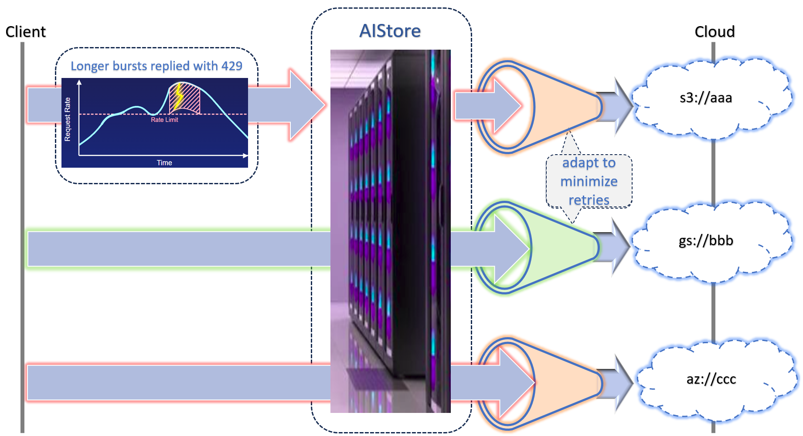

AIStore rate-limits traffic at two layers: frontend (client-facing) and backend (cloud-facing). It paces requests to stay within limits, and backs off and retries when limits are encountered anyway — all configurable at both the cluster and bucket levels, with zero performance overhead when disabled.

> Rate limiting was introduced in v3.28; v5.3 added the on-demand backend mode (see [Backend Activation Modes](#backend-activation-modes)).



This text explains how it all fits together.

## Table of Contents
1. [Background](#1-background)
2. [Elements](#2-elements)
   - [Pacing and Retries](#21-pacing-and-retries)
   - [Frontend vs. Backend](#22-frontend-vs-backend)
3. [Configuration](#3-configuration)
   - [Configuration: Summary Table](#31-configuration-summary-table)
4. [Unified Rate-Limiting Logic](#4-unified-rate-limiting-logic)
   - [Backend Activation Modes](#backend-activation-modes)
5. [Handling Batch Jobs](#5-handling-batch-jobs)
6. [Use Cases](#6-use-cases)
   - [Handling Backend-Imposed Limits](#61-handling-backend-imposed-limits)
   - [Limiting User Traffic](#62-limiting-user-traffic)
     - [Limiting User Traffic: Example `aisloader` run](#63-limiting-user-traffic-example-aisloader-run)
   - [Combined Frontend/Backend Limiting for Cross-Cloud Transfer](#64-combined-frontendbackend-limiting-for-cross-cloud-transfer)
7. [Monitoring and Troubleshooting](#7-monitoring-and-troubleshooting)
   - [GET Performance Table](#get-performance-table)
   - [PUT Performance Table](#put-performance-table)
   - [Quick Troubleshooting Summary](#quick-troubleshooting-summary)
8. [Recap](#8-recap)

## 1. Background

The original motivation was to **gracefully handle** rate-limited cloud storage such as Amazon S3, Google Cloud Storage (GCS), and other remote [backends](https://github.com/NVIDIA/aistore/blob/main/docs/overview.md#at-a-glance).

One common misconception is that integrating with systems that impose their own rate constraints boils down to simply retrying failed requests with exponential backoff.

Not true! In reality, such integrations are always a balancing act: the goal is to **minimize retries** while running at the **maximum allowed speed** - which further requires configuration, runtime state, and a few more elements explained below.

---

## 2. Elements

### 2.1 Pacing and Retries

**Pacing** keeps requests within permitted throughput before hitting any system-imposed limits—cloud or otherwise. By governing the flow of requests in real time, we reduce the need for retries.

**Retries** come into play when the external service or remote storage actually enforces a limit (returning [429](https://developer.mozilla.org/en-US/docs/Web/HTTP/Reference/Status/429) or [503](https://developer.mozilla.org/en-US/docs/Web/HTTP/Reference/Status/503)).

When that happens, we respond with adaptive backoff and retry logic - **but only** if the corresponding bucket has its backend rate limiter configured: bucket-configured (`enabled`) or on-demand (`on_demand`); see [Backend Activation Modes](#backend-activation-modes). This gives us a self-adjusting mechanism that converges on the maximum permissible speed with minimal overhead.

---

### 2.2 Frontend vs. Backend

"AIStore has a unique dual identity: it acts as **reliable distributed storage** (managing local and remote buckets) while also serving as a **fast tiering layer** for other systems."

1. **Bursty (Frontend)**
   - Frontend rate limiting is provided by each AIS proxy (or gateway).
   - The system allows short-term spikes but enforces an overall maximum request rate.
   - When clients exceed the allowed rate, they receive HTTP `429` immediately.

2. **Adaptive or Shaping (Backend)**
   - Backend rate limiting is handled by each AIS target node.
   - There's a stateful rate-limiter instance on a per `(bucket, verb)` basis, where the verbs are: `GET`, `PUT`, and `DELETE`.
   - This logic dynamically adjusts request rates based on current usage and responses from the remote service.
   - If a remote backend returns `429` or `503`, AIS target may engage exponential backoff to stay under the cloud provider's limits.

---

## 3. Configuration

Rate limiting is configured **per bucket**, with **inheritable defaults** set at the **cluster level**. Buckets automatically inherit the global settings, but each bucket can override them at creation time or any point thereafter. For reference, see `RateLimitConf` in [cmn/config.go](https://github.com/NVIDIA/aistore/blob/main/cmn/config.go).

```console
$ ais config cluster rate_limit --json
```
```json
    "rate_limit": {
        "backend": {
            "num_retries": 3,
            "interval": "1m",
            "max_tokens": 1000,
            "enabled": false
        },
        "frontend": {
            "burst_size": 375,
            "interval": "1m",
            "max_tokens": 1000,
            "enabled": false
        }
    }
```

This includes:

- **Rate-Limit Policies**: Separate policies for frontend (bursty) and backend (adaptive or shaping) rate limiting.
- **Performance Requirement**: If rate limiting is **not** enabled for a particular bucket or cluster, there should be **no** performance penalty.
- **Proportional Distribution**:
  - On the front, each AIS proxy assumes it handles `1 / nap` share of incoming requests, where `nap` is the current number of active proxies in the cluster.
  - On the back, each target node assumes it is one of `nat` targets accessing the same remote bucket in parallel, and computes its share accordingly.

For a given bucket, configuration may look as follows:

```console
$ ais bucket props set s3://abc rate_limit

PROPERTY                                 VALUE
rate_limit.backend.enabled               true     <<<< (values that differ from cluster defaults will be highlighted)
rate_limit.backend.interval              10s      <<<<
rate_limit.backend.max_tokens            35000    <<<<
rate_limit.backend.num_retries           5
rate_limit.backend.per_op_max_tokens

rate_limit.frontend.burst_size           375
rate_limit.frontend.enabled              false
rate_limit.frontend.interval             1m
rate_limit.frontend.max_tokens           1000
rate_limit.frontend.per_op_max_tokens
```

### 3.1 Configuration: Summary Table

| Parameter | Description |
|-----------|-------------|
| `enabled` | Enables/disables rate limiting for frontend or backend |
| `on_demand` | (Backend only) On-demand: no pacing until the first backend `429`/`503`. Mutually exclusive with `enabled`. Defaults to `false`. |
| `interval` | Time window for token replenishment (e.g., "1m", "10s") |
| `max_tokens` | Maximum number of operations allowed in the interval |
| `burst_size` | (Frontend only) Maximum burst allowed above steady rate |
| `num_retries` | (Backend only) Maximum number of retry attempts when handling `429` or `503` |
| `per_op_max_tokens` | Optional per-operation (GET/PUT/DELETE) token configuration |

Cluster defaults apply to newly created buckets, while existing buckets retain their properties and can be configured independently.

---

## 4. Unified Rate-Limiting Logic

Although frontend and backend differ in their specific mechanisms (bursty vs. shaping), the underlying logic is unified:

- **Frontend**: Each proxy enforces a configurable rate limit on a per-bucket and per-operation (verb) basis.

- **Backend**: Each target enforces the configured limit for outbound calls. This is wrapped by a dedicated `ais/rlbackend` layer that shapes traffic to remote AIS clusters or external clouds (e.g., S3, GCS).

### Backend Activation Modes

The backend limiter runs in one of two mutually exclusive modes:

| `enabled` | `on_demand` | Mode |
|-----------|-------------|------|
| `false` | `false` | Off |
| `true` | `false` | **Bucket-configured**: paces requests from the start |
| `false` | `true` | **On-demand**: no pacing until the first `429`/`503` for a given bucket and operation on a target; that response activates the limiter |
| `true` | `true` | Rejected |

- Once active, both modes pace requests and retry rate-limit errors using the bucket's `max_tokens`, `interval`, and `num_retries`.
- An explicitly enabled (bucket-configured) limiter takes precedence: setting both `enabled` and `on_demand` to `true` fails, in cluster configuration and bucket properties alike.
- The check applies to the resulting (merged) configuration: for instance, setting `on_demand=true` on a bucket that already has `enabled=true` fails as well.
- On-demand activation is one-way: once activated, the limiter keeps pacing, while its learned rate recovers gradually as the remote stops throttling.
- Switching `on_demand` off and back on does not reset the learned rate; a limiter that stays idle for several hours is discarded.

Here's a simplified snippet of bucket-configured logic (`enabled=true`) with (4) inline comments:

```go
func (bp *rlbackend) GetObj() (int, error) {
	// 1. find or create rate limiter instance; pace up front to optimize out error handling
	arl := bp.acquire(bucket, http.MethodGet)

	// 2. fast path
	ecode, err := bp.Backend.GetObj()
	if !IsErrTooManyRequests(err) {
		return ecode, err
	}

	// 3. generic retry with a given backend and method-specific callback
	cb := func() (int, error) {
		return bp.Backend.GetObj()
	}
	total, ecode, err := bp.retry()

	// 4. increment retry count, add `total` waiting time to retry latency
	bp.stats()

	return ecode, err
}
```

- **Lazy Pruning**: Over time, not all buckets remain active, so the system utilizes common [housekeeping](https://github.com/NVIDIA/aistore/blob/main/hk/common_durations.go) mechanism to lazily prune stale rate-limiter instances.

### Backend Retry Waits

Once active, `rlbackend` acquires a token once before each operation. After a backend `429` or `503`, retries use backoff without acquiring additional tokens; errors still contribute to the shared limiter's error statistics.

- Each wait starts from the larger of the previous retry sleep and the current token-derived interval.
- The error percentage determines the multiplier: **2x** at 30% or below, **4x** above 30%, and **8x** above 50%. With fewer than three recorded requests, the multiplier is 2x.
- Before jitter, each sleep is capped at the larger of **6 seconds** (`DfltRateMaxWait / DfltRateMaxRetries`) and the current token-derived interval. Retries remain bounded by `num_retries` (at most 10) and a one-minute retry-sleep budget.
- Each wait applies approximately +/-3% jitter after capping, so it can slightly exceed that base cap, but never falls below the token-derived interval. The resulting sleep is carried forward to the next retry.
- The previous sleep belongs only to the current operation. A later operation starts without that accumulated delay.

Ignoring jitter, for one isolated operation with a fresh limiter, a 10ms base interval, and every attempt returning `429`, ten retries sleep for **20ms, 40ms, 80ms, 160ms, 320ms, 640ms, 1.28s, 2.56s, 5.12s, 6s** (16.22s total). A successful retry or a non-rate-limit error ends the retry loop.

---

## 5. Handling Batch Jobs

AIStore supports numerous batch jobs that read and transform data across buckets. For example, a job might read data from one bucket, apply a user-defined transformation, and then write the results to another bucket. Multiple rate-limiting scenarios can arise:

- **Source Bucket**:
  - May or may not be rate-limited.
  - Could be limited on the frontend, the backend, or both.
- **Destination Bucket**:
  - Could also have its own rate-limiting policies.
  - Might be a remote system with enforced limits (e.g., writing to an S3 bucket).

At first, the permutations may seem too numerous, but in reality it is easy to state a single rule:

- Frontend rate-limiting is enforced by a given running job and is _conjunctive_ (source and/or destination wise). When both limits are defined one of them will most likely "absorb" the other.
- Backend is controlled by the corresponding `(bucket, verb)` rate limiter that keeps adjusting its runtime state based on the responses from remote storage. The same limiter serves client requests and all jobs, in either mode (see [Backend Activation Modes](#backend-activation-modes)).

---

## 6. Use Cases

### 6.1 Handling Backend-Imposed Limits

**Scenario**: You have an S3 bucket with a known rate limit of 3500 requests per second.

**Configuration**:
```console
$ ais bucket props set s3://abc rate_limit.backend.enabled=true rate_limit.backend.interval=10s \
  rate_limit.backend.max_tokens=35000
```

### 6.2 Limiting User Traffic

"You want to limit the maximum number of client requests to a specific bucket to 20,000 per minute. Further, the cluster in question happens to have 10 AIS gateways (and a load balancer on the front)."

**Configuration**:
```console
$ ais bucket props set ais://nnn rate_limit.frontend.enabled=true rate_limit.frontend.interval=1m \
  rate_limit.frontend.max_tokens=2000 rate_limit.frontend.burst_size=100
```

This configures a given bucket to:
- Limit client requests to 20,000 per minute (notice that 2000 * 10 = 20,000).
- Allow short bursts up to 100 additional requests.
- Return status `429` ("Too Many Requests") if clients exceed these limits.

### 6.3 Limiting User Traffic: Example `aisloader` run

```console
$ ais bucket props set ais://nnn rate_limit.frontend.enabled true rate_limit.frontend.max_tokens 2000 rate_limit.frontend.burst_size 500
"rate_limit.frontend.burst_size" set to: "500" (was: "375")
"rate_limit.frontend.enabled" set to: "true" (was: "false")
"rate_limit.frontend.max_tokens" set to: "2000" (was: "1000")

Bucket props successfully updated.
```

And then:

```console
$ aisloader -bucket=ais://nnn -cleanup=false -numworkers=8 -quiet -pctput=100 -minsize=1k -maxsize=1k --duration 5m -randomproxy
Found 0 existing objects

Runtime configuration:
{
   "stats interval": "10s",
   "proxy": "http://ais-endpoint",
   "bucket": "nnn",
   "provider": "ais",
   "namespace": "",
   "duration": "5m0s",
   "backed by": "sg",
   "PUT upper bound": "0",
   "minimum object size (bytes)": 1024,
   "maximum object size (bytes)": 1024,
   "# workers": 8,
   "% PUT": 100,
   "seed": "1744663719184760811",
   "cleanup": false
}


Time      OP    Count                   Size (Total)            Latency (min, avg, max)                 Throughput (Avg)        Errors (Total)
16:48:50  PUT   11 (11 8 0)             11.0KiB (11.0KiB)       1.101ms    1.060s     7.135s            1.10KiB/s (1.10KiB/s)   -
PUT failed: ErrRateLimitFrontend: Too Many Requests
PUT failed: ErrRateLimitFrontend: Too Many Requests
...
```

### 6.4 Combined Frontend/Backend Limiting for Cross-Cloud Transfer

**Scenario**: You are migrating or copying data from GCS to S3 and need to respect both providers' limits.

**Configuration**:
```console
# Configure source S3 bucket
$ ais bucket props set s3://src rate_limit.backend.enabled=true rate_limit.backend.interval=10s \
  rate_limit.backend.max_tokens=50000

# Configure destination Google Cloud bucket
$ ais bucket props set gs://dst rate_limit.backend.enabled=true rate_limit.backend.interval=10s \
  rate_limit.backend.max_tokens=33000
```

When running a copy or transform job between these buckets, AIStore automatically respects both rate limits without (requiring) any additional configuration.

---

## 7. Monitoring and Troubleshooting

There are statistics and Prometheus metrics to [monitor](/docs/monitoring-overview.md) all performance-related aspects including (but not limited to) rate-limiting.

Below are two tables - one for `GET`, another for `PUT` - that illustrate how the performance monitoring might look for an AIStore cluster under the described rate-limited scenario.

---

### GET Performance Table

```console
$ ais performance latency --refresh 10 --regex get
```

| TARGET | AWS-GET(n) | AWS-GET(t) | GET(n) | GET(t) | GET(total/avg size) | RATELIM-RETRY-GET(n) | RATELIM-RETRY-GET(t) |
|:------:|:----------:|:----------:|:------:|:------:|:--------------------:|:---------------------:|:---------------------:|
| T1     | 800        | 180ms      | 3200   | 25ms   | 12GB / 3.75MB       | 50                    | 240ms                |
| T2     | 1000       | 150ms      | 4000   | 28ms   | 15GB / 3.75MB       | 70                    | 230ms                |
| T3     | 700        | 200ms      | 2800   | 32ms   | 10GB / 3.57MB       | 40                    | 215ms                |

- **AWS-GET(n)** / **AWS-GET(t)**: Number and average latency of GET requests that actually hit the AWS backend.
- **GET(n)** / **GET(t)**: Number and average latency of *all* GET requests (including those served from local cache or in-cluster data).
- **GET(total/avg size)**: Approximate total data read and corresponding average object size.
- **RATELIM-RETRY-GET(n)** / **RATELIM-RETRY-GET(t)**: Number and average latency of GET requests retried due to hitting the rate limit.

---

### PUT Performance Table

```console
$ ais performance latency --refresh 10 --regex put
```

| TARGET | GCP-PUT(n) | GCP-PUT(t) | PUT(n) | PUT(t) | PUT(total/avg size) | RATELIM-RETRY-PUT(n) | RATELIM-RETRY-PUT(t) |
|:------:|:----------:|:----------:|:------:|:------:|:--------------------:|:---------------------:|:---------------------:|
| T1     | 3200       | 75ms       | 4000   | 50ms   | 12GB / 3MB          | 40                    | 210ms                |
| T2     | 4200       | 85ms       | 5200   | 60ms   | 15GB / 2.88MB       | 50                    | 200ms                |
| T3     | 2500       | 90ms       | 3300   | 58ms   | 10GB / 3.03MB       | 35                    | 205ms                |

- **GCP-PUT(n)** / **GCP-PUT(t)**: Number and average latency of PUT requests that actually went to Google Cloud Storage.
- **PUT(n)** / **PUT(t)**: Number and average latency of *all* PUT requests processed.
- **PUT(total/avg size)**: Approximate total data written and the corresponding average object size.
- **RATELIM-RETRY-PUT(n)** / **RATELIM-RETRY-PUT(t)**: Number and average latency of PUT requests retried due to rate limiting on the destination bucket.

---

These tables can vary widely, primarily depending on the percentage of source data that is in-cluster, but also on:

- **Rate-limit settings** for both the source (AWS) and the destination (GCP).
- **Total number of disks** in the cluster.
- **Object sizes**, **current workload from other running jobs**, **available network bandwidth**, etc.

In practice, you’d adjust the rate-limit `interval` and `max_tokens` (and potentially other AIStore config parameters) to match your workload and performance requirements.

### Quick Troubleshooting Summary

| Issue | Possible Cause | Solution |
|-------|----------------|----------|
| Excessive `429` errors from cloud storage | Rate limit set too high | Lower `max_tokens` value for the bucket |
| Performance degradation with rate limiting enabled | Unnecessarily low limits | Increase `max_tokens` or disable if not needed |
| Client occasionally receives "Too Many Requests" | Burst size too small | Increase `burst_size` |
| Client keeps receiving `429` or `503` from its Cloud bucket | Rate limit not configured | Enable and tune up backend rate limiter on the bucket |

---

## 8. Recap

The objective is to maintain linear scalability and high performance while safeguarding against external throttling or internal overload.

The solution features:

- **Bursty** (frontend) and **adaptive** (backend) rate limiters configurable on a per-bucket basis.
- **Pacing**, to keep runtime errors and retries to a minimum.
- **Adaptive backoff and retries**, to gracefully handle 429s and 503s from remote storages.
